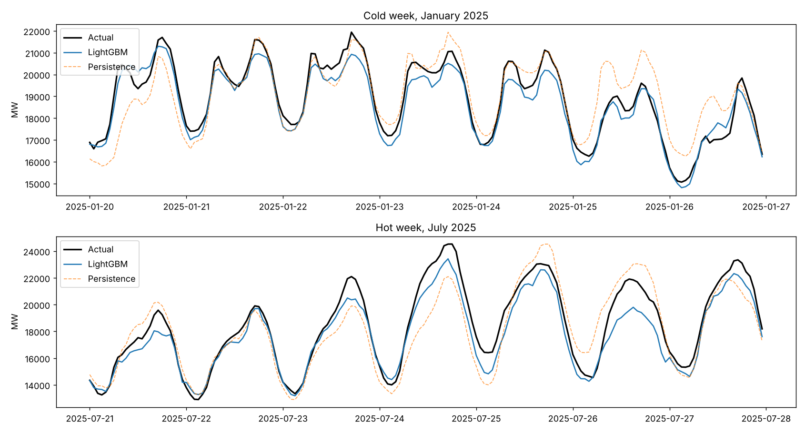
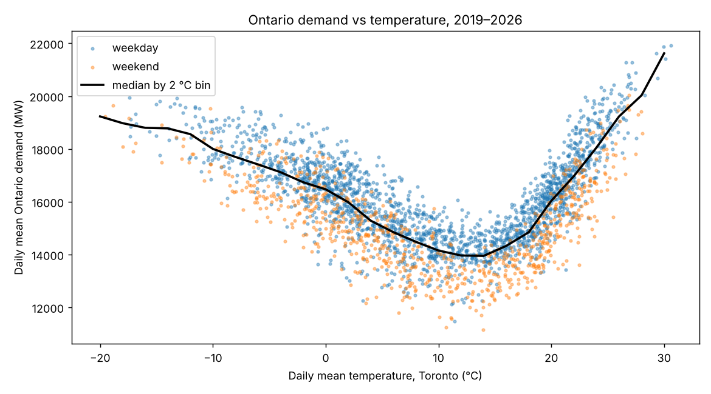
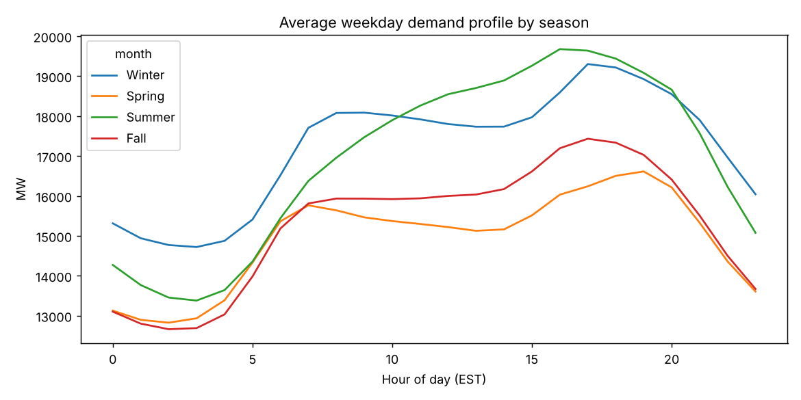

# Ontario Electricity Demand Forecasting

[](https://github.com/zekiyerdem/ontario-demand-forecast/actions/workflows/tests.yml)

Day-ahead forecasting of Ontario's hourly electricity demand using public IESO data (2019–2026) and hourly weather.

**Result on the 2025 test year:** a LightGBM model with calendar and weather features forecasts next-day hourly demand with **2.6% MAPE (448 MW MAE)**, **41% lower error** than the "same hour yesterday" baseline, and predicts each day's peak within **2.8%** on average.



## Results — 2025 test year (8,760 hours, never used in training)

| Model | MAE (MW) | RMSE (MW) | MAPE (%) | Daily peak MAPE (%) |
|---|---:|---:|---:|---:|
| Persistence (same hour yesterday) | 758 | 1,030 | 4.6 | 3.8 |
| Weekly persistence (same hour last week) | 1,197 | 1,673 | 7.0 | 6.6 |
| Ridge regression (calendar + weather + lags) | 576 | 719 | 3.5 | 3.1 |
| LightGBM, no weather features | 638 | 876 | 3.7 | 3.9 |
| **LightGBM, with weather features** | **448** | **583** | **2.6** | **2.8** |

Setup: at the end of day D-1, forecast all 24 hours of day D. Train 2019–2023, tune on 2024, refit on 2019–2024, test on 2025.

## Key findings

- **Demand is U-shaped in temperature.** Lowest around a 12–14 °C daily mean, rising with heating load in winter and steeply with cooling load above ~25 °C. A linear correlation (r ≈ 0.02) misses this entirely.

  

- **Weather is what makes the model useful.** Removing weather features raises MAPE from 2.6% to 3.7%, and the daily-peak forecast becomes no better than persistence.
- **Summer peaks are the hardest.** June–July errors are highest (~3.0–3.3% MAPE). The model under-forecasts the afternoon peak on the hottest days, which are rare in the training data.
- **Load is growing.** Average 2025 demand was ~4% above 2024 (16,621 vs 15,986 MW), the largest year-over-year increase since 2019.
- **Seasonal shape differs.** Winter weekdays have morning and ~18:00 evening peaks; summer has one broad afternoon cooling peak.

  

## Notebooks

| Notebook | What it covers |
|---|---|
| `01_exploration.ipynb` | Loading 2025 IESO data, timestamp handling, daily/weekly profiles, winter peak analysis |
| `02_weather_and_baselines.ipynb` | Demand–temperature relationship, seasonal profiles, annual trend, persistence baselines |
| `03_day_ahead_models.ipynb` | Ridge and LightGBM day-ahead models, weather ablation, 2025 test, error by month, feature importance |

## Data

- **Demand:** [IESO public hourly demand reports](https://reports-public.ieso.ca/public/Demand/). IESO reports in Eastern Standard Time all year (no daylight saving).
- **Weather:** hourly Toronto temperature, humidity and cloud cover from the [Open-Meteo historical archive](https://open-meteo.com/), pulled on the same fixed UTC-5 clock so it lines up with IESO hours.
- One missing hour (2025-05-01 00:00) is linearly interpolated.

**Assumption:** the models use *observed* weather for the forecast day as a stand-in for a day-ahead weather forecast, so real operational accuracy would be somewhat lower.

## Project structure

```
src/data.py        download + merge IESO demand and weather (cached to data/)
src/features.py    calendar, holiday, heating/cooling-degree and lag features
tests/             pytest unit tests for the feature pipeline (incl. a no-leakage check)
figures/           charts used in this README
results/           baseline and test-set metric tables (CSV)
```

## Run it

```bash
pip install -r requirements.txt
python -m src.data                 # downloads data into data/
jupyter notebook                   # run notebooks 02 and 03
python -m pytest                   # unit tests (no data download needed)
```

The tests run on small synthetic series. Besides checking lags, degree-days and holiday flags, they verify there is no leakage: changing demand on the forecast day never changes that day's features. GitHub Actions runs them on every push (Python 3.11 and 3.12).

## Next steps

- Archived weather *forecasts* instead of observed weather
- Population-weighted temperature across Ontario cities; humidex for summer peaks
- Probabilistic (quantile) forecasts for peak-risk planning
- SARIMAX and LSTM comparisons

**Stack:** Python, pandas, scikit-learn, LightGBM, matplotlib
